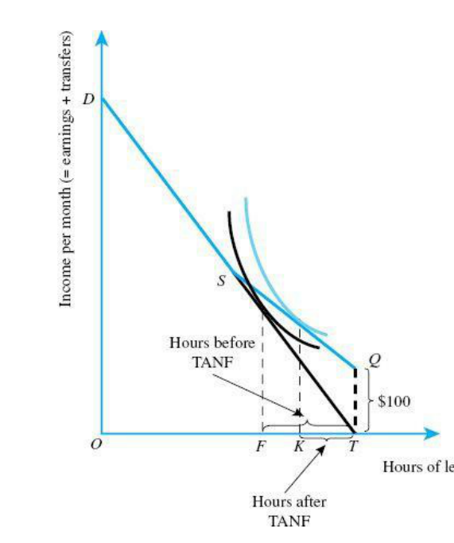

# Week 4: Redistribution — finish pack

Updated 13 October 2026. Four textbook theory questions, then three exact exam blocks (17 marks). No solutions included.

## How to resume

Start at Question 1. Questions 1–2 were discussed with feedback; restate them independently. Questions 3–7 are new. Work one full question at a time with brief non-specific theory, then attempt, then a small hint only if needed. Do not mark supported completion as independent mastery.

The original tutorial Exercises 4.1–4.5 were completed with varying support. Calculation refreshers and changed variants are explicitly deferred to another day. Government preference reporting remains deferred. After this Week 4 finish block, move to Week 3 asymmetric information.

## Questions

## 1. Cash equivalent of an in-kind benefit

Theory · revisit after feedback

Source: Rosen & Gayer, Public Finance, 10th ed., Ch. 12, Discussion Question 3, PDF p. 414. Adapted wording; the market-value follow-up is added.

A government replaces an in-kind benefit, such as free public transportation, with cash. Using indifference curves and budget constraints, explain how to determine the cash payment that leaves the recipient equally well off. Is that payment necessarily equal to the benefit’s market value?

## 2. Basic income and the phase-out problem

Theory · revisit after feedback

Source: Rosen & Gayer, 10th ed., Ch. 13, Discussion Question 3, PDF p. 448. Adapted wording; the phase-out assumption is retained from the textbook’s hint.

A commentator proposes replacing existing welfare programmes with a basic income and simplifying taxes to encourage everyone to work harder. Evaluate this proposal, considering that the basic income is reduced as earnings rise to keep the programme affordable. What does this imply for work incentives?

## 3. What does a social welfare function imply?

Theory · new

Source: Rosen & Gayer, 10th ed., Ch. 12, Discussion Question 7, PDF p. 414. Transcribed with mathematical typography normalised; checked against the original PDF.

An economy consists of two individuals, Lynne and Jonathan, whose utility levels are given by U_L and U_J, respectively.

**(a)** Suppose that the social welfare function is W = U_L + U_J. True or false: Society is indifferent between giving a dollar to Lynne and a dollar to Jonathan.

**(b)** Now suppose that, instead, the social welfare function is W = U_L + 8U_J. True or false: Society values Jonathan’s happiness more than Lynne’s.

**(c)** Now suppose that, instead, the social welfare function is W = min[U_L, U_J]. True or false: In this society, the optimal distribution of income is complete equality.

## 4. A welfare recipient who chooses not to work

Theory / graph · new

Source: Rosen & Gayer, 10th ed., Ch. 13, Discussion Question 6, PDF pp. 449–450; Figure 13.4 on PDF p. 424. Transcribed.

In the analysis of TANF’s work incentives in Figure 13.4, the individual continues to work while receiving welfare. Reproduce the budget constraint from that figure, and sketch a set of indifference curves for an individual who would choose not to work while receiving welfare benefits.

## 5. Optimal income allocation and costly redistribution

Exact exam · 6 marks · not attempted

Source: 24 October 2025 Final, original Question 6(a–c), grading-scheme PDF pp. 11–12. Question text transcribed; equations/typesetting restored from the PDF. Only numbering changed.

Consider a society that must divide a total sum of Y euro between two individuals, Agnes and Berta. Utility of Agnes is given by U_A = √I_A and utility of Berta is given by U_B = β√I_B, where I_A and I_B are the amounts of money that Agnes and Berta receive, respectively, and β > 0 is a parameter. You can assume that I_A + I_B = Y. The social welfare function of this society equals SW = wU_A + U_B, where w > 0 is a parameter.

**(a · 2 marks)** Calculate the amounts of I_A and I_B that maximise social welfare.

**(b · 2 marks)** The amount of I_A that maximises social welfare depends positively on w. Explain why (so: why is I_A optimally higher if w is higher?). Use maximally two sentences.

**(Context for c)** Now suppose that the government is involved in this (re)distribution. In the absence of redistribution, Agnes would obtain the complete amount Y and Berta would obtain 0. Thus, without redistribution I_A = Y and I_B = 0. Redistribution by the government leads to a loss in efficiency. This efficiency loss increases in the amount of money redistributed.

**(c · 2 marks)** Compared to the amount of I_B as derived under question a), will Berta now receive more, less, or the same amount? Explain your answer in a few sentences.

## 6. A welfare budget constraint and efficiency loss

Exact exam · 7 marks · not attempted

Source: 7 July 2026 Resit, original Question 2(a–c), grading-scheme PDF pp. 4–7. Transcribed with mathematical typography normalised. Only numbering changed.

Bert has 200 hours per month which he has to divide between working and leisure. His net wage is 20 euro per hour. Leisure L is the number of hours (out of the 200) that he does not spend working (hence, L = 200 - number_hours_work). The government has introduced the following system of poverty alleviation: People who have less than 500 euro per month earnings from work receive a grant of 600 euro per month. For people who earn more than 500 euro per month, the grant is reduced by 50 cents for every euro earnings from work above 500 euro. People who earn 1700 euro or more from work receive no grant. You can ignore taxes throughout this exercise.

**(a · 3 marks)** Draw Bert's budget constraint, with total net income on the Y-axis and number of hours of leisure on the X-axis. Clearly indicate the relevant points on the budget constraint on both axes (with numbers).

**(Context for b)** Bert has diminishing marginal utility of both income and leisure (such that his indifference curves relating to the trade-off between income and leisure have the normal shape (convex) ). Suppose that if the government would not have a system of poverty alleviation (grant is 0 for everyone), Bert would choose to work 85 hours (L=115).

**(b · 2 marks)** Argue whether Bert works more than 85 hours, less than 85 hours, or exactly 85 hours given that the government has introduced the poverty alleviation system as described above. Argumentation is crucial. (Hint: Calculations are neither necessary nor possible. You can use a new sketch of Bert's budget constraint in you argumentation.)

**(c · 2 marks)** Suppose you would know Bert's utility function. Then, it would be possible to calculate the loss of efficiency due to Bert's response to the introduction of this poverty alleviation system. What steps must you take to calculate this? Note: you do not need to perform the calculation. It is not sufficient to mention terms; you must clearly indicate the steps required to carry out this calculation.

## 7. Job search, efficiency and distribution

Exact exam · 4 marks · not attempted

Source: 7 July 2026 Resit, original Question 4(a–c), grading-scheme PDF pp. 10–11. Transcribed with equations restored from the PDF and literal bold-formatting commands rendered as emphasis. Only numbering changed.

Suppose that the citizens of a country differ in productivity α. This productivity α is uniformly distributed between 0 and 1. A citizen with productivity α who has a job earns income Y = 2500α euro. A citizen without a job earns income Y = 225 euro. Utility of income is given by U = √Y. Searching for a job is difficult and time-consuming, and yields a loss in utility equal to c. If a citizen searches for a job, the probability that the citizen finds a job is given by π. A citizen who does not search never gets a job. Citizens maximise their expected utility.

The government considers introducing the following system of poverty alleviation. Citizens who earn less than 625 euro receive a benefit that increases their total income to 625 euro (such that the benefit equals 625 − own_earnings). The government cannot observe an individual's productivity α, but can observe earnings and whether citizens search for a job. Throughout the exercise, you can ignore taxes.

**(a · 2 marks)** Suppose π = 0.8 and c = 8. Determine which citizens search for a job before the introduction of the benefit system.

**(Context for b–c)** The introduction of the system of poverty alleviation may reduce efficiency, because fewer citizens search for a job. A politician proposes to give the benefit only to citizens that engage in job search. In other words, people only get the benefit if they searched for a job and earn less than 625 euro (either because they did not find a job or because their job pays less than 625 euro). A citizen who did not search for a job, does not receive any benefit (implying that the citizen has an income of 225 euro).

**(b · 1 mark)** Explain (in words) why the politician's proposal to make job search mandatory for receiving benefits could reduce efficiency. Use no more than three sentences.

**(c · 1 mark)** Suppose the politician's proposal to make job search mandatory for receiving benefits increases efficiency. From a normative perspective, why could it still be optimal to not make job search mandatory? Use no more than two sentences.
